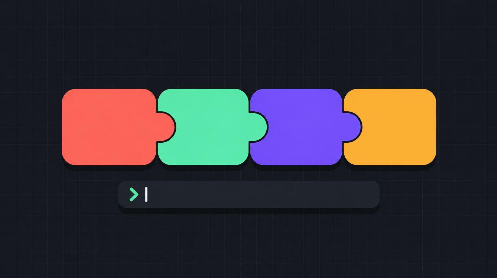

<p align="center">
  
</p>

# Claude Code Mods

Пять небольших модов для Claude Code. Они показывают кэш и расход над полем ввода, подсказывают следующий шаг, ведут бэклог проекта и следят, чтобы тесты шли раньше кода.

Моды работают во всех чатах сразу, грузятся прямо из папки и обновляются сами, без перезапуска.

<p>


</p>

> Неофициальный проект, не связан с Anthropic. Моды в Claude Code пока в раннем доступе, поэтому их API может измениться. Проверено на Windows 10 и 11. Тексты в модах русские.

## Что внутри

| Мод | Версия | Что делает | Где найти |
| --- | --- | --- | --- |
| ⏱ cache-timer | v0.3.3 | Показывает, сколько минут осталось до остывания кэша и сколько токенов в контексте. Кнопка "Сжать" запускает /compact. За 5 минут до остывания всплывает напоминание. | блок над полем ввода |
| 💸 spend-meter | v0.6.0 | Одна строка про весь проект: сколько он стоил по ценам API (оценка, подписка столько не списывает), сколько стоили бы ваши часы работы (1 200 ₽ в час) и сами часы. В /spend расход и время по сессии, дням, лимиты подписки и бюджет проекта. | блок над полем ввода, /spend |
| → quick-steps | v0.6.0 | После ответа показывает до трёх подсказок "что дальше", лучшая первой и с пометкой "(Рекомендую)". Цифра 1, 2 или 3 в пустом поле ввода сразу отправляет подсказку, 0 прячет их. Подсказки придумывает недорогая модель (Haiku) по свежей части разговора. | блок над полем ввода |
| 🧪 tdd | v0.1.0 | Тесты до кода. Кнопка "Добавить в проект" записывает правила в CLAUDE.md проекта, и агент сразу работает по ним, с модом или без. Два вида ворот, для каждого проекта отдельно (выкл, наблюдать, блокировать): на правку (код не правится, пока не тронут тест) и на коммит (нет коммита без свежего зелёного прогона тестов). Слова "без тестов" в вашем сообщении снимают блок на этот раз. | /tdd |
| 📋 backlog | v0.3.0 | Бэклог проекта сбоку: что сделать потом, между чатами. Три вкладки: текущие, выполненные, все. Свежие сверху, у каждого пункта дата. Claude сам добавляет туда отложенное и закрывает сделанное. Пункт уходит в работу одной кнопкой. У сделанной задачи кнопка "отчёт": Claude пишет клиенту короткий человеческий отчёт без технических подробностей, в одном блоке, который копируется одной кнопкой. | /backlog |

Четыре мода рисуют один общий блок над полем ввода. Плашка TDD всегда на виду: показывает, как с TDD в проекте, напоминает его включить и открывает панель одним нажатием.

```text
⏱ кэш: 42 мин · контекст: 61k из 200k (31%)  [Сжать]   [TDD: включить?]   ₽ проект 3 480 ₽ · ваш труд 14 400 ₽ · 🕐 12 ч

→ дальше:
  1  Прогони тесты модуля auth
  2  Закоммить изменения
```

## Установка

Нужны Windows 10 или 11, Git и Claude Code версии 2.1.284 или новее.

1. Скачайте моды в папку Claude:

```powershell
git clone https://github.com/kitay-sudo/claude-code-mods "$env:USERPROFILE\.claude\mods"
```

2. Включите их:

```powershell
powershell -ExecutionPolicy Bypass -File "$env:USERPROFILE\.claude\mods\install.ps1"
```

3. Откройте новый чат. Над полем ввода появится строка с кэшем и расходом, а команды /spend и /backlog заработают.

Скрипт прописывает папки модов в `~/.claude/settings.json` (переменные `CLAUDE_CODE_PLUGIN_DIRS` и `CLAUDE_CODE_PLUGIN_DIR_WATCH`), остальные настройки не трогает и оставляет рядом копию прежних: `settings.json.before-mods.json`. Повторный запуск безопасен.

**Моды не видны в терминальном `claude`.** Включите флаг раннего доступа и перезапустите терминал:

```powershell
[Environment]::SetEnvironmentVariable('CLAUDE_CODE_ENABLE_FUNCTION_HOOKS', '1', 'User')
```

**Нужны не все моды.** Впишите нужные папки через `;` в `env.CLAUDE_CODE_PLUGIN_DIRS` в `~/.claude/settings.json`, а в `env.CLAUDE_CODE_PLUGIN_DIR_WATCH` поставьте `1`.

**Через Claude.** Напишите в чате: "Поставь моды из репозитория kitay-sudo/claude-code-mods".

## Настройка

Параметры лежат в `<мод>/.claude-plugin/plugin.json`, в блоке `userConfig`. Поменяйте значение `default`, и изменение подхватится через пару секунд.

| Мод | Параметр | По умолчанию | Что значит |
| --- | --- | --- | --- |
| cache-timer | `cacheTtl` | `1h` | Срок жизни кэша: `1h` или `5m`. |
| spend-meter | `rubPerUsd` | `87` | Курс: рублей за доллар. |
| spend-meter | `humanRubPerHour` | `1200` | Сколько стоит час вашей работы. Из него считается "ваш труд": все часы проекта на эту сумму. |
| quick-steps | `suggestModel` | `haiku` | Модель для подсказок. `session` включает модель самого чата с полным разговором: подсказки точнее, но токенов уходит заметно больше. |
| quick-steps | `digitKeys` | `true` | Цифры 1, 2, 3 и 0 в пустом поле ввода. Выключите, если нужно начинать сообщение с цифры, пока подсказки на экране. |
| quick-steps | `minAnswerChars` | `80` | После ответов короче этого подсказок нет. |
| quick-steps | `suggestSkills` | `true` | Подсказка может быть слэш-командой из ваших скилов. |

## Что уходит из компьютера

- quick-steps после ответа отправляет модели Haiku сжатый кусок разговора: последние сообщения и ответ. Это обычный запрос в вашем аккаунте Claude Code. Чтобы подсказок не было совсем, уберите папку quick-steps из `CLAUDE_CODE_PLUGIN_DIRS`.
- Остальные моды ничего не отправляют по сети.
- Данные модов (расход, время, бэклог) лежат только у вас: `%USERPROFILE%\.claude\plugins\store\*_inline-*.json`.

## Обновление и удаление

Обновить:

```powershell
git -C "$env:USERPROFILE\.claude\mods" pull
```

Открытые чаты подхватят изменения сами. Если в наборе появился новый мод, запустите `install.ps1` ещё раз.

Удалить: уберите папки модов из `env.CLAUDE_CODE_PLUGIN_DIRS` в `~/.claude/settings.json` и удалите папку `%USERPROFILE%\.claude\mods`. Файлы данных `*_inline-*.json` можно оставить или удалить.

## Разработка

Каждый мод это папка с `.claude-plugin/plugin.json`, `hooks/register.tsx` и тестами в `tests/`. Проверка одного мода или всех сразу:

```powershell
powershell -ExecutionPolicy Bypass -File .\check.ps1 quick-steps
```

Без имени проверяются все моды, обновляются бейджи и версии в таблице выше. Правила правки модов лежат в [CLAUDE.md](CLAUDE.md).

## Лицензия

[MIT](LICENSE). quick-steps основан на моде next-steps Thariq Shihipar (тоже MIT), подробности в [quick-steps/NOTICE.md](quick-steps/NOTICE.md).
